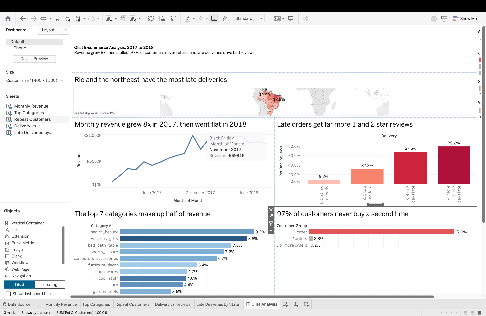

# Olist E-commerce Analysis (SQL + Tableau)

I analyzed about 96,000 orders from Olist, a Brazilian online marketplace, using SQL. I looked at how the business grew, whether customers come back, and what makes them leave bad reviews. Then I built a Tableau dashboard and wrote three recommendations.

**[View the live dashboard on Tableau Public](https://public.tableau.com/app/profile/nidhi.prasad/viz/OlistE-CommerceAnalysis_17923664285060/OlistAnalysis)**

Data: [Brazilian E-Commerce Public Dataset by Olist](https://www.kaggle.com/datasets/olistbr/brazilian-ecommerce) on Kaggle. 9 linked tables, orders from 2016 to 2018. All amounts are in Brazilian reais (R$).

## Key findings

1. **Revenue grew about 8 times in 2017, then went flat in 2018.** Monthly revenue went from R$112K (January 2017) to R$925K (January 2018), with the biggest month at Black Friday (November 2017). From March to August 2018 it stayed flat. Growth came from more orders, not bigger ones: the average order stayed around R$135.
2. **97% of customers buy only once.** Only 3% ever come back. So all growth depends on finding new customers, which explains why revenue stopped growing when new customer growth slowed.
3. **The top 10% of customers bring in 41% of revenue,** but they average just 1.1 orders. They're big one time buyers, not regulars.
4. **The top 7 categories make up half of revenue.** Watches and gifts ranks second with far fewer orders than bed bath and table, because its items cost twice as much.
5. **Late deliveries drive bad reviews.** Late orders are only 6.7% of orders, but 79% of orders more than a week late get a 1 or 2 star review, compared with 9% of on time orders. Late orders cause about a third of all bad reviews.
6. **Customers forgive slow, not late.** The northeast and Rio de Janeiro have the most late deliveries (up to 22% of orders). The Amazon states take the longest (over 3 weeks) but are rarely late, because their promised dates are realistic, and their reviews stay high.

## Recommendations

1. **Bring customers back,** starting with big first time buyers, for example with follow up emails or a discount on a second order.
2. **Fix late deliveries.** It's the fastest way to improve ratings.
3. **Set realistic delivery dates** for Rio de Janeiro and the northeast, and work with carriers on Rio first, since it has the most late orders.

## How I did it

* Loaded the 9 CSV files into a **DuckDB** database with Python.
* Wrote one SQL file per question, using **CTEs, joins, window functions** (LAG, NTILE, running totals) and **cohort analysis**.
* Exported results to CSV and built the dashboard in **Tableau**.

**Choices I made:**
* Revenue counts **delivered orders only**, and uses item price without shipping.
* I used **January 2017 to August 2018**, because earlier and later months are incomplete.
* Each order gets a new `customer_id`, so I used **`customer_unique_id`** to find real repeat customers. Without this, retention looks like zero.

**Limitations:** Olist is a marketplace, so some customers may come back through other sellers or accounts. The data covers only about 20 months, so slow repeat buyers aren't fully captured.

## Questions and SQL files

| Question | File |
|---|---|
| How many orders are in each status? | `sql/00_order_status.sql` |
| How are revenue and orders growing? | `sql/01_monthly_revenue.sql` |
| Which categories bring in the most money? | `sql/02_top_categories.sql` |
| How many customers buy more than once? | `sql/03_repeat_customers.sql` |
| Do customers come back month to month? | `sql/04_cohort_retention.sql` |
| How much revenue comes from top customers? | `sql/05_top_customers.sql` |
| Do late deliveries lead to bad reviews? | `sql/06_delivery_vs_reviews.sql` |
| Which states have the slowest deliveries? | `sql/07_delivery_by_state.sql` |

## How to run it

1. Download the dataset from Kaggle and put the 9 CSV files in `data/raw/`.
2. Run:

~~~
conda create -n ecommerce python=3.12 -y
conda activate ecommerce
pip install -r requirements.txt
python load_data.py                              # build the database
python run_sql.py sql/01_monthly_revenue.sql     # run any question
~~~

## Folders

~~~
sql/         one SQL file per question
dashboard/   query results (CSV) and the Tableau workbook
docs/        screenshots
~~~
